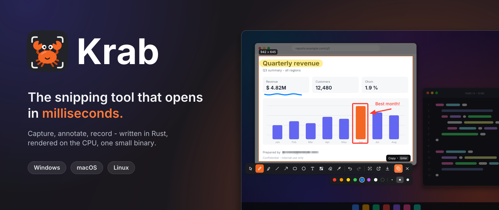
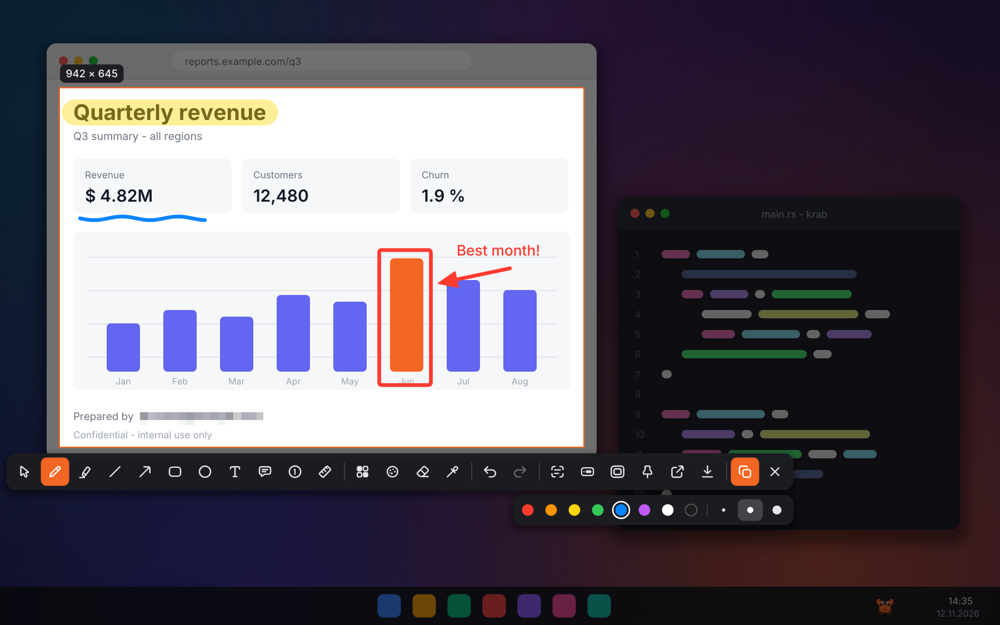
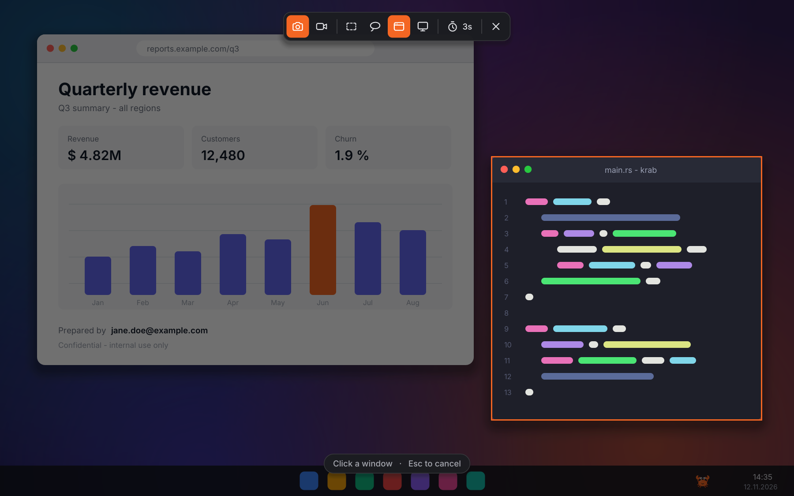
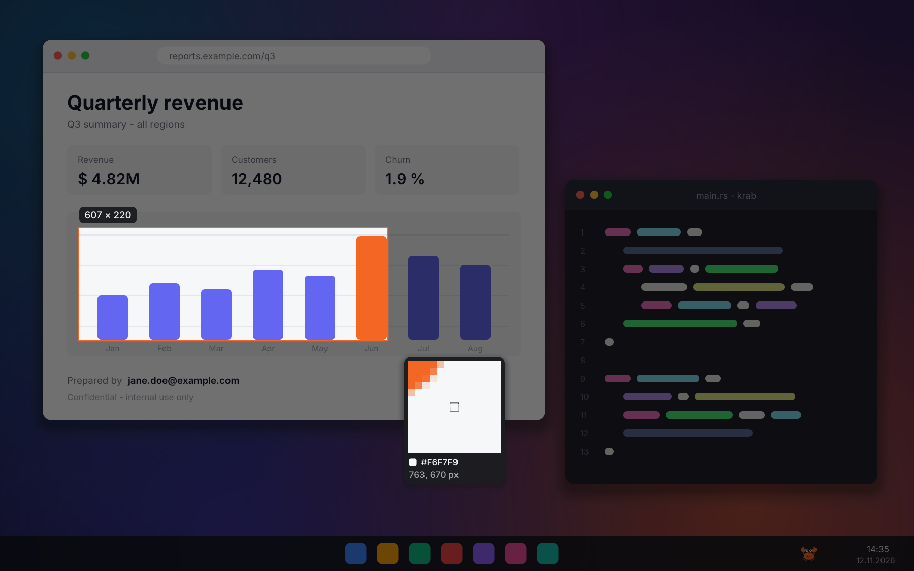
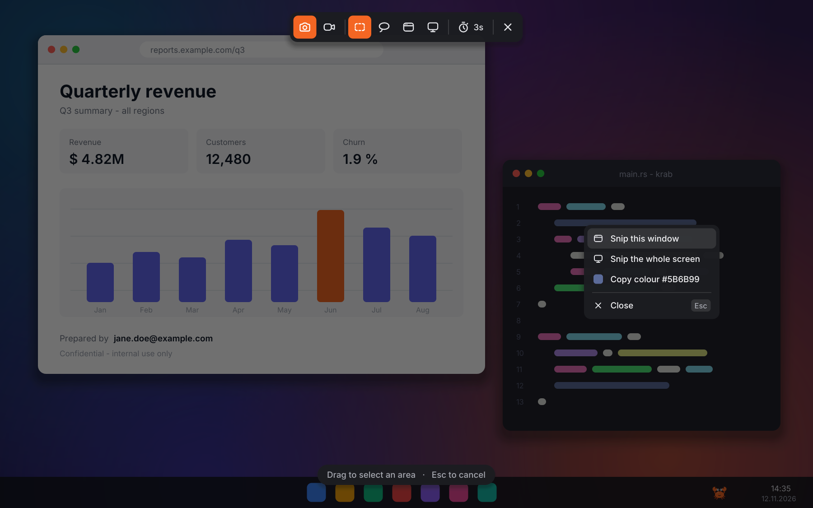
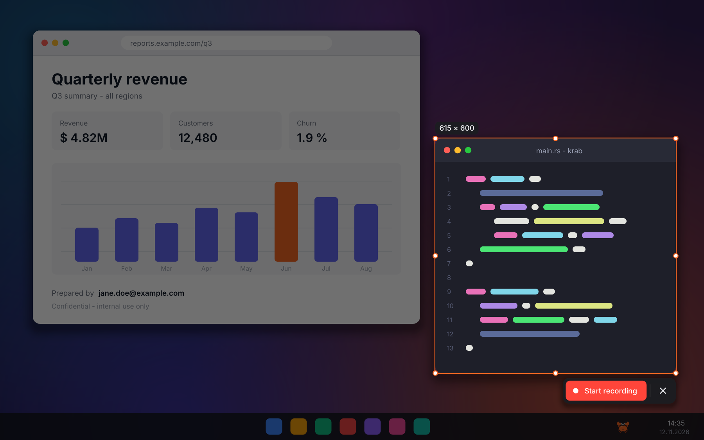
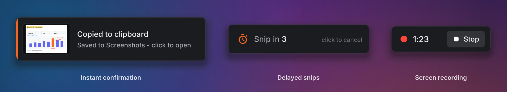
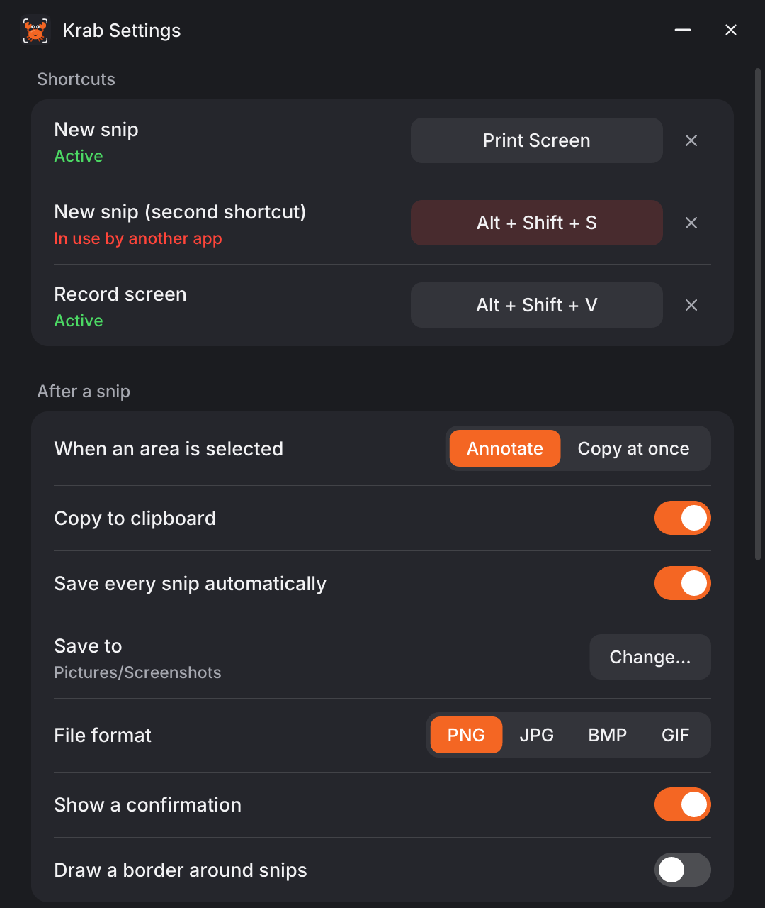

<p align="center">
  
</p>

# Krab

**Krab** is a lightweight snipping tool that is on screen before you have finished pressing the key.
Select an area, mark it up, copy it. No splash screen, no GPU warm-up, no Electron: one small native binary
written in Rust.

The name is a nod to [Ferris](https://rustacean.net/), the Rust crab, plus *grab*.


## Why it is fast

| | Measured |
|---|---|
| Hotkey to overlay, Krab running in the background | **40 - 50 ms** |
| Cold start (`krab` with nothing running) to overlay | **about 70 ms** |
| Handing a request to the background instance | under 1 ms |
| Idle memory of the background instance | 14 MB working set, 2.4 MB private |
| Download | one 2.3 MB executable |

Measured on Windows 11 with a single 1920x1080 display. Most of the time is the screen grab itself.
Run `krab --trace` to see the numbers on your machine.

Krab draws everything itself on the CPU, grabs the screen while its window is still opening and keeps that
window ready in the background, so there is nothing to warm up.

## What it looks like

Select, then annotate in place:



Window snips highlight what you are about to capture:



A pixel loupe for exact edges and colours:



Right-click for everything else - snip the window under the pointer, copy a colour's hex code, save, undo:



Screen recording and status feedback:




Settings in one window - shortcuts, what happens after a snip, and the app itself:

<p align="center"></p>

## Features

Everything the Windows Snipping Tool does day to day, plus a few things it does not:

| | Krab |
|---|---|
| Rectangle, freeform, window and full-screen snips | yes |
| Delayed snips (3 / 5 / 10 s, or any value from the command line) | yes |
| Pen, highlighter, eraser | yes |
| Shapes: line, arrow, rectangle, ellipse | yes |
| Text | yes |
| Pixelate / redact | yes |
| Colour picker with pixel loupe (copies the hex value) | yes |
| Crop after selecting (move and resize handles, arrow keys) | yes |
| Undo / redo | yes |
| Copy to clipboard | yes |
| Save as PNG, JPEG, BMP or GIF | yes |
| Automatic save to `Pictures/Screenshots` | yes |
| Text extraction (OCR) and QR codes | yes - see notes below |
| Screen recording | yes, MP4 with ffmpeg or GIF without - no audio |
| Open the snip in another app | yes (system default app) |
| Tray / menu bar icon and start with the system | yes |
| Global shortcuts for snips and recording, changeable in the settings | yes (Linux: on X11) |
| Settings window | yes |
| Optional border around every snip | yes |
| Multiple monitors | yes, one overlay per monitor (one selection at a time) |
| Command line and scripting | yes |
| Automatic updates | yes |

Not included: audio in recordings, the share sheet, printing, and HDR colour correction.

## Install

Download the archive for your system from the
[releases page](https://github.com/Mailo037/krab/releases), unpack it and open `krab`. On its first start Krab
installs itself as a regular app for your user - no administrator rights needed - and starts from there:

| System | Installed to | Find it in |
|---|---|---|
| Windows | `%LOCALAPPDATA%\Programs\Krab` | Start menu, search, *Settings > Apps* |
| macOS | `~/Applications/Krab.app` | Launchpad, Spotlight, Finder |
| Linux | `~/.local/bin/krab` | your desktop's app menu |

It also turns on *Start when I log in* (switch it off in the settings) and opens the settings once.
The downloaded file can be deleted afterwards.

To remove Krab, uninstall it in *Settings > Apps* on Windows, or run `krab --uninstall`. Your settings and
screenshots are kept.

| System | File |
|---|---|
| Windows 10 / 11 (x64) | `krab-windows-x64.zip` |
| macOS 11+ (Apple silicon and Intel) | `krab-macos-universal.tar.gz` |
| Linux (x86_64, X11 or Wayland, glibc 2.39+ such as Ubuntu 24.04) | `krab-linux-x86_64.tar.gz` |

Krab keeps itself up to date - see [Updates](#updates).

### Platform notes

After the first snip Krab stays in the tray (the menu bar on macOS), so the shortcuts work and the next snip
opens instantly. Click the icon for a snip, or open its menu for everything else, including **Settings**.
Turn on *Start when I log in* in the settings to have it there right away.

**Windows** - the shortcuts are `PrintScreen` and `Alt+Shift+S` for a snip and `Alt+Shift+V` for a recording.
Windows 11 puts new tray icons into the overflow menu (the `^` arrow); drag Krab onto the taskbar to keep it in
sight. If Windows opens its own Snipping Tool on `PrintScreen`, the settings window offers to turn that off.

**macOS** - the first capture asks for the *Screen Recording* permission (System Settings > Privacy & Security).
The program is not signed; remove the quarantine flag after downloading (`xattr -d com.apple.quarantine krab`)
before opening it the first time.
Default shortcut: `Cmd+Shift+2`. After an update macOS may ask for the permission once more.

**Linux** - the tray icon appears on KDE, Xfce, Cinnamon, Budgie and Ubuntu's desktop; on plain GNOME it needs
the *AppIndicator* extension. Shortcuts set in Krab's settings work on X11. Wayland does not let applications
register shortcuts, so there bind the `krab` command (or `krab --record`) to a key in your desktop's keyboard
settings. Screen capture on Wayland uses PipeWire 1.0 or newer.

**Text extraction** uses the OCR engine built into Windows. On macOS and Linux it calls
[`tesseract`](https://github.com/tesseract-ocr/tesseract) if it is installed. QR codes are decoded by Krab itself
on every platform.

**Recording** writes H.264 MP4 when `ffmpeg` is on your `PATH`, and animated GIF otherwise.

## Updates

Krab updates itself. Once a day it looks for a new version on the releases page, downloads it, checks it
against the published checksums and replaces itself - a running background instance restarts into the new
version as soon as you are not in the middle of a snip or a recording, and tells you when it is done.

- Check right now: *Check for updates* in the tray menu, or `krab --update`.
- Turn the automatic check off: `auto_update = false` in the configuration.
- Updates need `curl`, which comes with Windows 10 / 11 and macOS and is installed on practically every Linux
  desktop, and write access to the folder Krab is in.

## Usage

```text
krab [MODE] [OPTIONS]      take a snip
krab --daemon              run in the background (tray icon + global shortcuts)
krab --settings            open the settings window

MODES:
    rect          drag a rectangle (default)
    window        click a window
    full          the whole screen
    freeform      draw any shape

OPTIONS:
    -d, --delay <SECONDS>      wait before capturing (menus, hover states...)
    -r, --record               record the screen instead of taking a picture
    -c, --copy                 copy as soon as the area is selected
    -e, --edit                 always open the markup tools after selecting
    -o, --output <FILE>        also save the result to FILE (png, jpg, bmp, gif)
        --now                  capture the full screen right now, no overlay
        --standalone           do not reuse the background instance

BACKGROUND INSTANCE:
        --daemon               start it
        --quit                 stop it
        --autostart <on|off>   start Krab when you log in
        --config               open the configuration file
        --update               install the newest version now
        --install              install Krab as an app (done automatically on first start)
        --uninstall            remove the installed app
```

Examples:

```sh
krab                      # drag an area, annotate, press Enter to copy
krab window --copy        # click a window, it is on the clipboard immediately
krab full --now -o a.png  # scripted full-screen capture, no UI at all
krab --delay 5            # five seconds to open that menu first
krab --record             # choose an area and record it
```

### Keyboard and mouse

| While selecting | |
|---|---|
| `R` `F` `W` `M` | rectangle, freeform, window, full screen (monitor) |
| `Esc` | cancel |
| right click | menu: snip this window, the whole screen, copy the colour under the pointer |

| After selecting | |
|---|---|
| `Enter`, `Ctrl+C` or double click | copy and close |
| `Ctrl+S` | save as... |
| `Ctrl+Z` / `Ctrl+Y` | undo / redo |
| `Ctrl+A` | select the whole screen |
| `V` `P` `H` `L` `A` `R` `E` `T` `B` `X` `I` | move, pen, highlighter, line, arrow, rectangle, ellipse, text, pixelate, eraser, colour picker |
| arrow keys (`Shift` = 10 px, `Ctrl` = resize) | nudge the selection |
| `Shift` while drawing | straight strokes, 45 degree lines, squares and circles |
| mouse wheel | stroke size |
| `Esc` | step back (text, then selection, then close) |
| right click | menu: copy, save, copy text, copy colour, select the window under the pointer, undo |

On macOS use `Cmd` instead of `Ctrl`.

### Configuration

Everything below can be changed in the settings window (tray menu > *Settings*, or `krab --settings`); changes
apply immediately. The values live in `config.toml` - `krab --config` opens it, and `KRAB_CONFIG` points Krab
to a different file.

To change a shortcut, click it in the settings and press the new keys (`Esc` cancels, `Backspace` removes it).
Each shortcut shows whether it works; if another app already uses the combination, it says so and you can pick
another one or clear it with the `x` button.

```toml
hotkey = "PrintScreen"
hotkey_alt = "Alt+Shift+S"
hotkey_record = "Alt+Shift+V"     # start / stop a screen recording
run_in_background = true       # stay in the tray after the first snip
default_mode = "rect"          # rect | freeform | window | full
after_capture = "edit"         # "edit" = annotate in place, "copy" = copy immediately
copy_to_clipboard = true
auto_save = true
save_dir = ""                  # empty = Pictures/Screenshots
file_format = "png"            # png | jpg | bmp | gif
jpeg_quality = 92
notifications = true
border = false
border_color = "#F46623"
border_width = 2
loupe = true
delay_seconds = 3
record_fps = 30
color = "#FF3B30"
auto_update = true             # install new versions automatically
```

## License

[MIT](LICENSE). The bundled [Inter](https://rsms.me/inter/) typeface is licensed under the
[SIL Open Font License](assets/fonts/LICENSE.txt).
